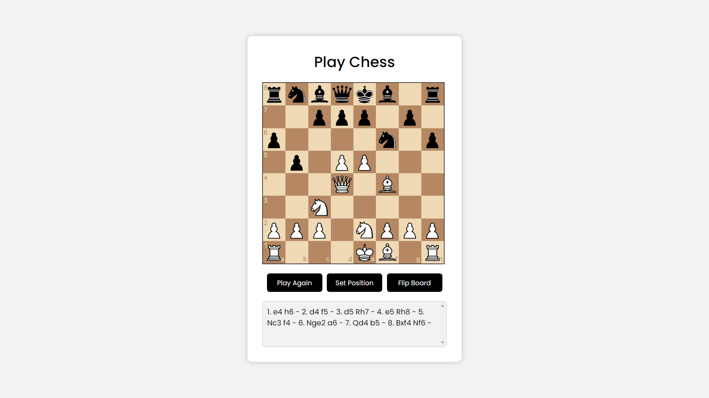

# Chess Game

Play chess in the browser against a computer opponent that picks random legal moves.

## Features

- Drag-and-drop board (chessboard.js) with move validation (chess.js)
- Move history list
- Flip board, play again, or load a position from a FEN string
- End-of-game message for checkmate, stalemate and draws

## Run it

No build step. Open `index.html` in a browser, or serve the folder with any static server, for example `python -m http.server`.

## Notes

- jQuery, chess.js and chessboard.js load from a CDN, so an internet connection is needed.

## Screenshots

